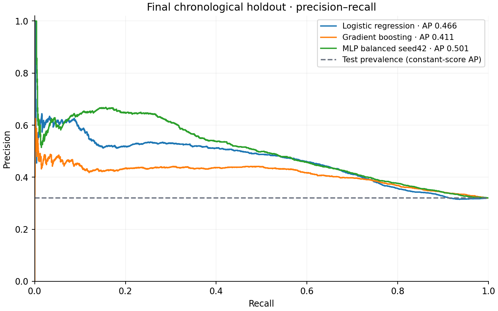
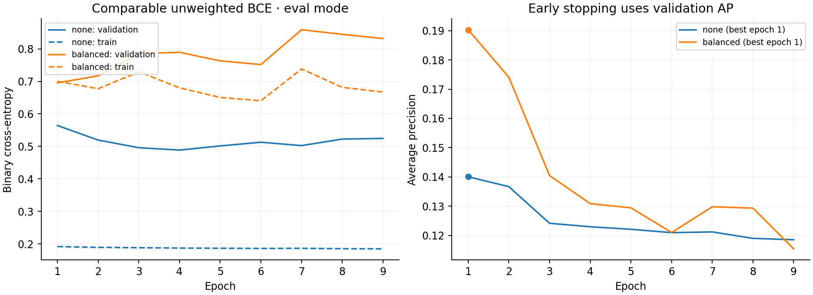
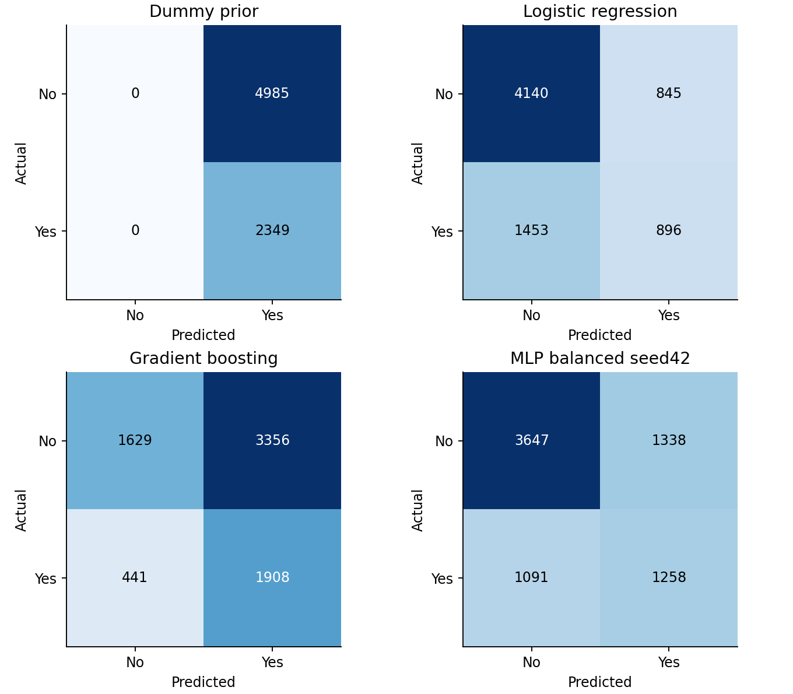

# Results from the executed experiment

Run: `full`. Completed: 2026-10-14T10:33:47.232696+00:00. Runtime: 2.59 seconds (cpu, 2 threads). Python 3.13.7; PyTorch 2.9.0; scikit-learn 1.7.2.

This report is generated from saved predictions and checks every metric before rendering. Smoke runs verify execution only; their scores are not research findings.

## Data and drift

Original observations: 41,188. Exact duplicate rows: 12. Later identical predictor patterns excluded: 6,675; patterns with conflicting outcomes: 710. Duplicates are defined on the retained original predictors, without consulting outcomes. Exclusions can remove distinct customers with identical profiles.

| Full-data partition | Retained n | Positive prevalence | Observed pdays (not sentinel) |
|---|---:|---:|---:|
| train | 19,976 | 4.79% | 6 |
| validation | 7,203 | 10.77% | 167 |
| test | 7,334 | 32.03% | 1,334 |

These are full-data audit counts; smoke runs subsample them. Previous-contact distance has very few observed training values. Median imputation makes its training variance small, so standardization can amplify later values outside that range. This is a concrete extrapolation risk and may contribute to unstable validation curves; this diagnostic does not establish causality. Selected MLP checkpoint epochs in this run: 1, 1, 1, 1. Future validation studies could compare robust scaling or a different history representation. No preprocessing changes were made in response to test scores.

## Validation experiment

Question: does positive-class weighting improve MLP ranking (average precision)? Only the BCE positive weight changes; architecture, regularization, data, seed and stopping rule are fixed.

| Candidate | Validation AP | ROC-AUC | Best epoch | Epochs run | Fit + validation seconds |
|---|---:|---:|---:|---:|---:|
| MLP none seed42 | 0.1400 | 0.5514 | 1 | 9 | 0.91 |
| MLP balanced seed42 | 0.1903 | 0.6264 | 1 | 9 | 0.28 |
| MLP balanced seed43 | 0.1532 | 0.5763 | 1 | 9 | 0.27 |
| MLP balanced seed44 | 0.1491 | 0.5810 | 1 | 9 | 0.28 |

Selected weighting: **balanced**. Model family chosen by validation AP: **MLP balanced seed42**. The primary MLP is the predeclared selection seed, not the best test seed. Additional seeds repeat the selected configuration; each has its own validation-selected checkpoint and threshold.

Fixed-baseline validation AP: Dummy prior 0.1077; Logistic regression 0.1756; Gradient boosting 0.0975.

## Final test metrics

Thresholds maximize validation F1; ties choose the higher threshold. Predictions use score ≥ threshold. They are not retuned on the final holdout. F1 is a teaching objective, not a business cost model.

| Model | AP | ROC-AUC | Precision | Recall | F1 | Threshold | TN / FP / FN / TP |
|---|---:|---:|---:|---:|---:|---:|---|
| Dummy prior | 0.3203 | 0.5000 | 0.3203 | 1.0000 | 0.4852 | 0.047857 | 0 / 4985 / 0 / 2349 |
| Logistic regression | 0.4659 | 0.6469 | 0.5146 | 0.3814 | 0.4381 | 0.086331 | 4140 / 845 / 1453 / 896 |
| Gradient boosting | 0.4115 | 0.6242 | 0.3625 | 0.8123 | 0.5012 | 0.030256 | 1629 / 3356 / 441 / 1908 |
| MLP balanced seed42 | 0.5006 | 0.6699 | 0.4846 | 0.5355 | 0.5088 | 0.519956 | 3647 / 1338 / 1091 / 1258 |
| MLP balanced seed43 | 0.4482 | 0.5734 | 0.4077 | 0.4713 | 0.4372 | 0.505606 | 3377 / 1608 / 1242 / 1107 |
| MLP balanced seed44 | 0.4659 | 0.6076 | 0.4773 | 0.4483 | 0.4623 | 0.500749 | 3832 / 1153 / 1296 / 1053 |

Test size: 7,334; positive prevalence: 32.03%. The constant-score dummy predicts everybody positive under validation-F1 selection; its recall is 1 and precision is prevalence. This is expected, not a useful calling policy.

Across 3 MLP seeds: test AP mean 0.4716, sample standard deviation 0.0267, range 0.4482–0.5006. This measures training randomness on one fixed split, not sampling uncertainty or a confidence interval.

The highest test AP among the two classical baselines (Logistic regression) does not exceed the primary MLP. It exceeds 1 of the 3 MLP seed results. This is a descriptive comparison after freezing choices; the validation-selected model is unchanged. A neural network is not automatically better on tabular data: inductive bias, sample size and temporal drift matter.

Loss plots use unweighted BCE in evaluation mode for both configurations, allowing like-for-like comparison. Weighted optimization loss is also saved in histories.json; it is on a different scale. The best AP checkpoint can precede the minimum validation BCE.

## Error patterns

- MLP balanced seed42: 1,338 false positives (unnecessary calls in this framing), 1,091 false negatives (missed subscribers); 26.8% false-positive rate and 46.4% false-negative rate.

Descriptive subgroup checks (small groups are noisy; these are not a fairness audit):

| Model | Group | n | Prevalence | Precision | Recall |
|---|---|---:|---:|---:|---:|
| MLP balanced seed42 | contact=cellular | 6425 | 0.335 | 0.485 | 0.560 |
| MLP balanced seed42 | contact=telephone | 909 | 0.219 | 0.474 | 0.271 |
| MLP balanced seed42 | poutcome=failure | 2042 | 0.229 | 0.491 | 0.120 |
| MLP balanced seed42 | poutcome=nonexistent | 4094 | 0.258 | 0.348 | 0.482 |
| MLP balanced seed42 | poutcome=success | 1198 | 0.690 | 0.680 | 0.838 |

## Interpretation limits

One chronological partition cannot establish a general ranking. Row order approximates time; exact dates and client IDs are absent. Temporal prevalence shifts, unknown categories, repeat customers, and the duplicate-pattern exclusion policy affect evaluation. The dataset contains contacted customers and retrospective outcomes, so it cannot establish the causal value of a call. No random-split experiment, calibration study, fairness audit or production validation was executed. The weighting search uses one seed; repeated seeds for both candidates and rolling-origin validation would strengthen the research.
